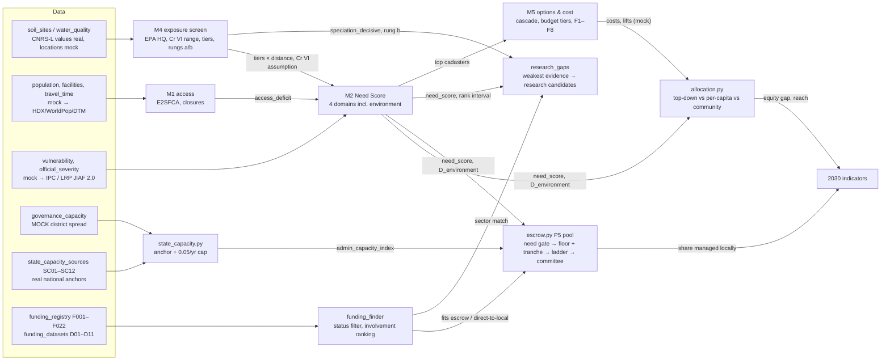

# Model linkage: what each model builds on, what it adds, and who consumes its outputs

Scope: M1–M5 plus the allocation simulator and the P5 escrow pool (the "adaptive funding switch", CLAUDE.md §13).
Rule (docs/FEASIBILITY.md): every number is sourced or labelled an assumption. Anything synthetic stays `is_mock=True`.
Source ids refer to `data/registry/sources.csv` (S…), `state_capacity_sources.csv` (SC…), `funding_registry.csv` (F…) and `funding_datasets.csv` (D…).

## Whiteboard relations (CLAUDE.md §13) as implemented

- **Money follows measured need.** M2 Need Score, blended with M4 environmental exposure (weight editable), sets which towns enter the pool and their share of it.
- **Control shifts with measured capacity.** The administrator ladder runs INGO → national NGO → Union of Municipalities → (MoPH only if allowed). It is keyed to district admin capacity, which is anchored to the national WGI value (SC01) with gains capped at 0.05 per year.
- **Communities decide use.** A community committee sets priorities at every rung. The allocation simulator tests this as a pilot arm against top-down allocation; it is not a result.
- **Four stresses:**
  - High need is measured by M2.
  - Low providership is measured by M1, plus staffing (mock, pilot-measured).
  - Disjointed referrals are an escrow threshold (pilot-measured).
  - NGO dependency is the share managed locally, an escrow output. Its baseline should come from D01–D03.
- **Environment into care.** M4 tiers feed the M2 environment domain and the escrow/allocation priority. Where M4 is uncertain (Cr speciation), the town becomes an implementation-research candidate (`research_gaps.py`).

## Model by model

### M1 Spatial access (`m1_access.py`)
- **Builds on:** the enhanced two-step floating catchment area method (E2SFCA; Luo & Qi 2009, Gaussian distance decay; literature, not yet in sources.csv) and the Health Sector threshold of 2 PHCs per 50,000.
- **Adds:**
  - a `baseline_pre2026` vs `current_2026` closure scenario (WHO sitrep closures, S03);
  - group-weighted demand (women 15–49 by displacement group, including estimated unregistered workers);
  - catchment sensitivity (15/30/60 min);
  - mobile-unit siting.
- **Inputs → outputs:** cadasters, population, facilities and travel time → `access_by_cadaster` (`access_current`, `access_lost`) and per-group access ratios.
- **Consumed by:** M2 (`access_deficit` in the capacity_strain domain); dashboard section 1.

### M2 Beqaa Need Score (`m2_need_score.py`)
- **Builds on:** the official Lebanon health-sector severity / JIAF 2.0 inter-sector district index (LRP 2026 Addendum, S15). That index is district-level, annual, and has **no environmental indicators**. M2 also builds on the Barake et al. Need Score concept (S002), which gives no formula, weights or thresholds.
- **Adds:**
  - cadaster resolution;
  - an **environment domain** fed by M4;
  - explicit safe/crisis thresholds (`need_score_indicators.yaml`);
  - an unregistered-workers share;
  - 5,000 Dirichlet weight draws (`p_top_tier`, rank intervals);
  - a district comparison against the official index (`compare_official`), with "hidden hotspots" that the district average masks.
- **Inputs → outputs:** M1 access; M4 soil tiers (with the Cr(VI) share used for tiering, precautionary by default); water nitrate; vulnerability → `need_score`, `D_environment`, tier, `p_top_tier`, and the new `speciation_uncertainty_nearby`, `rung_b_exposure_nearby` and `soil_hq_high_nearby`.
- **Consumed by:** allocation and escrow (priority, need gate), M5 (where to spend), `research_gaps` (need × evidence gap).

### M4 Exposure screen (`m4_exposure.py`)
- **Builds on:**
  - the EPA hazard-quotient method, HQ = ADD / RfD, with EPA default intake and body weight and the IRIS RfDs for Cr(III) and Cr(VI) (all `status: verify`);
  - the EPA 2024 residential lead soil screening level (200 ppm);
  - CNRS-L/MoE 2026 soil values (S001/S27; real values, mock locations);
  - Abi Saab et al. 2022 crop transfer (S003/S28; mock until transcribed).
- **Adds:**
  - the HQ reported as a **range** over the Cr(VI) fraction;
  - a crop pathway;
  - a Monte Carlo and tornado value-of-information ranking;
  - tiers 0–3 mapped to protective actions;
  - evidence rungs a/b/c (rung c is never assigned);
  - a `speciation_decisive` flag;
  - a user-set Cr(VI) share for tiering.
- **Inputs → outputs:** soil, crop transfer and exposure params → per-site HQ range, tier, rung, action, and the most valuable next evidence.
- **Consumed by:**
  - M2 environment domain (`soil_hotspot_proximity` = tier × distance decay);
  - escrow/allocation priority, through `D_environment` with weight *w* (sidebar);
  - `research_gaps` (speciation and rung-b gaps);
  - dashboard section 4.

### M5 Options & cost (`m5_options.py`)
- **Builds on:**
  - care-cascade modelling (ANC → ANC4 → facility delivery → postnatal + referral; Benage 2015, Tappis 2017; cascade values mock);
  - appeal-line costing (UNFPA/WHO appeals, F006/F007; costs mock);
  - the feasibility filter F1–F8 (docs/FEASIBILITY.md §2).
- **Adds:**
  - budget tiers ($1k / $100k / $1M);
  - Monte Carlo pathways and cost per pathway by group;
  - a collateral-damage checklist;
  - a feasibility flag per intervention.
- **Inputs → outputs:** interventions and the cascade baseline → reach, extra pathways, equity gap, fundable items per tier.
- **Consumed by:** allocation (unit effects, cost per woman); `research_gaps.intervention_gaps` (all costs and lifts are mock, so effect size and unit cost are implementation-research questions).

### Allocation simulator (`allocation.py`)
- **Builds on:**
  - community-driven development (CDD) and participatory allocation evidence: Mansuri & Rao 2013 (S35) and the 3ie WP30 synthesis (S26). Both find mixed effects on services, no reliable governance or cohesion gains, and real elite-capture risk.
  - the UNDP–MoSA LHSP Maps of Risks and Resources as the existing participatory process (S24).
- **Adds:**
  - three regimes (top-down by priority, per capita, community-decided) over the same priority towns;
  - capture safeguards (women's and workers' seats);
  - a sensitivity grid (capture 0.1–0.4 × local fit 1.0–1.3);
  - an allocation per district;
  - priority = (1 − w)·need + w·M4 exposure.
- **Inputs → outputs:** M2 scored table, M4 exposure, M5 unit effects → reach, pathways, unregistered share of reach, equity gap per regime and district.
- **Consumed by:** dashboard section 3 (framed as pilot test arms) and the 2030 indicators. The community arm is **an assumption to test**, not a finding.

### P5 escrow pool (`escrow.py` + `state_capacity.py` + `data/params/escrow_params.yaml`)
- **Builds on:**
  - the **Lebanon Humanitarian Fund allocation process** (OCHA country-based pooled fund: reserve and standard allocations through UN, INGO and national NGO partners; S18, F004; allocation data D01–D03). The pool is a **ring-fenced Beqaa window inside LHF/LFF**, not a new vehicle (FEASIBILITY §3).
  - process-indicator tranches. Cochrane 2021 (S25) finds pay-for-performance mixed, so the design keeps a guaranteed need floor and uses process triggers.
  - CDD (S26, S35) for the community committee.
- **Adds:**
  1. **Need gate:** a town enters only if `need_score ≥ need_score_min` (0.33, the Moderate tier). Priority = (1 − w)·need + w·`D_environment`.
  2. **Need floor:** guaranteed share (50%), released on need alone.
  3. **Capacity tranche:** released only if every threshold passes: referral completion ≥ 0.40 and posts filled ≥ 0.60 (both pilot-measured, mock now), transparent reporting, and district admin capacity ≥ 0.30. That last value is the **national anchor, WGI Government Effectiveness 2025 = 29.9/100 (SC01, to_verify_primary)**.
  4. **Administrator ladder** (who holds the money):
     - INGO from 0;
     - national NGO from 0.28 (the WGI 2023 low);
     - Union of Municipalities from 0.40 (assumption; councils elected May 2025 for six years, SC09);
     - MoPH from 0.514 (the WGI 2000 high). It is **off by default**: MoPH co-governs. Government pays 13.4% of health spending (SC02), and the MoPH budget fell from $486M in 2018 to $37M in 2022 (SC03, secondary).
  5. **Community committee decides use** at every rung. Allocation is reported per district.
  6. Restricted (hold) or unrestricted (reroute one rung down) routing, a renewed-escalation scenario, and lock-out and gaming warnings.
- **State capacity:** district `admin_capacity_index` is **MOCK**. Only its relative spread is kept: it is rescaled so that the 2026 district mean equals the national anchor (0.299). Projections use a capped gain (default 0.03/yr, maximum 0.05/yr; FEASIBILITY §5). Replace it with the UN-Habitat 2026 rapid municipal assessment (SC07).
- **Inputs → outputs:** M2/M4 priority, anchored governance, staffing and referrals (mock) → schedule per town and year; Sankey links (`flow_links`); role table (`role_table`); by-district totals; share managed locally / by Lebanese organisations.
- **Consumed by:** dashboard section 3 (Sankey, roles, anchor chart) and the 2030 indicators.

### Research gaps (`research_gaps.py`): M2 × evidence → implementation-research funding
- **Builds on:** the M4 value-of-information tornado and the evidence rungs, plus the M2 robustness intervals.
- **Adds:** a cadaster `evidence_gap_score` built from four gaps. Their weights are assumptions: speciation 0.35, rung b 0.25, imputed nitrate 0.15, rank instability 0.25.
  - `research_priority` = need × gap.
  - A cadaster is a candidate if need ≥ 0.33 and gap ≥ 0.40.
  - Each candidate gets a research question, a study design, and the **registry rows whose sectors match**. Only `funding_registry.csv` rows are used. Closed rows are excluded, and closed_recurring rows are shown as "expected next round".
  - Intervention-level gaps flag the mock cost/lift and the rung-b-only environmental measures.
- **Consumed by:** dashboard section 4, and `data/processed/research_candidates.csv` for the memo's "what evidence would change the response" (Q4).

### Funding finder (`funding_finder.py`)
- **Builds on:** the curated registry (F001–F022), reviewed for funding from about the last six months.
- **Adds:**
  - status handling:
    - verified / to_verify are shown;
    - closed_recurring is shown only behind a toggle, labelled "expected next round";
    - active_closed_to_new is shown as a precedent;
    - closed is hidden;
  - a **donor-involvement ranking**: core, flexible or institutional funding with high community-decision fit ranks first (the ordering is an assumption);
  - a "fits escrow" flag (poolable vs direct-to-local);
  - funding-flow data sources (D01–D11).
- **Never** creates rows.

## What is still mock or needs real data
- District governance capacity (replace with SC07), staffing and referral completion (pilot-measured), community priority weights, intervention costs and lifts, cascade baseline, soil site **locations**, crop transfer factors, official severity values (replace with S15).
- SC01 is a secondary mirror of the WGI and should be confirmed on the World Bank primary page. SC03 is secondary.
- The baseline for share managed locally should be computed from D01 (CBPF ProjectSummary by partner type).
